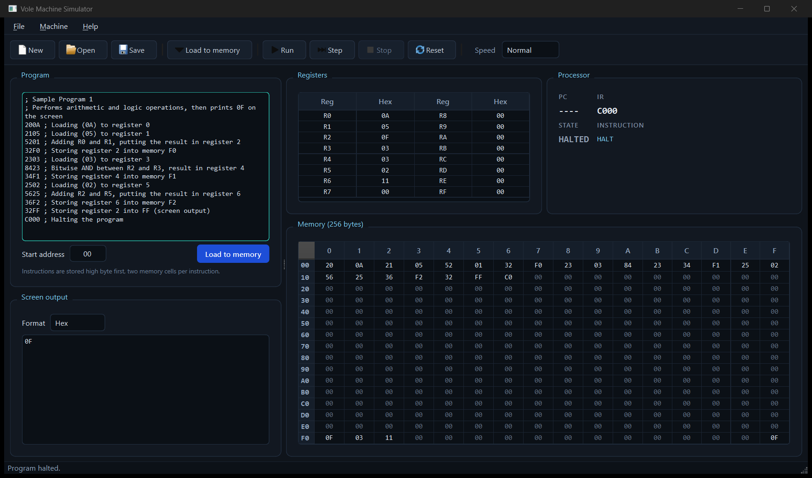

# Vole Machine Simulator

A complete C++17 implementation of the **Vole Machine** — a small 16-bit
educational computer — with a modern **Qt 6 Widgets** desktop interface.

The simulator executes Vole assembly programs, shows the CPU state while the
program runs, and lets you inspect and edit all 256 bytes of memory. The
project is split into a reusable simulator core (`source-code/`) and a Qt 6 GUI
front end (`gui/`).



---

## Table of contents

- [Overview](#overview)
- [Features](#features)
- [Project structure](#project-structure)
- [Requirements](#requirements)
- [Building with CMake](#building-with-cmake)
- [Running the simulator](#running-the-simulator)
- [Keyboard shortcuts](#keyboard-shortcuts)
- [Instruction set](#instruction-set)
- [Program file format](#program-file-format)
- [Screen output](#screen-output)
- [Example programs](#example-programs)
- [Architecture](#architecture)
- [Design documents](#design-documents)
- [Team](#team)
- [Academic context](#academic-context)

---

## Overview

The Vole Machine is a simplified stored-program computer used to teach the
fundamentals of computer organization and object-oriented design. It has:

- **256 bytes of memory** (addresses `00`–`FF`), where `FF` is mapped to the
  screen output.
- **16 general-purpose registers** (`R0`–`RF`), each holding one byte.
- **A program counter (PC)** and **instruction register (IR)**.
- **An ALU** supporting integer addition, floating-point addition, OR, AND,
  XOR, and bit rotation.
- **A control unit** that fetches, validates, decodes, and executes one
  instruction at a time.

This repository provides a full graphical front end for the machine: program
editing, loading, single-stepping, continuous execution, register/memory
inspection, and configurable screen output.

> This is a GUI-focused repository. The shared simulator core is kept separate
> from the interface so it can be reused by other front ends.

---

## Features

### Program editor

- One 4-digit hexadecimal instruction per line.
- `;` starts a comment; comments and blank lines are ignored.
- Start-address selector for even addresses from `00` to `FE`.
- Load the editor contents into memory with a single action.
- Open program files (`.txt`, `.vole`, `.asm`) and save the editor contents as
  a `.txt` program.

### Execution control

- **Run / Pause** continuous execution.
- **Single-step** through one instruction at a time.
- **Stop** (halt) the machine.
- **Reset** memory, registers, and the screen.
- Adjustable speed: **Slow**, **Normal**, **Fast**, and **Turbo**.

### Machine inspection

- Live register view (`R0`–`RF`) with hexadecimal values and signed tooltips.
- Program counter (`PC`) and instruction register (`IR`) display.
- Current machine state (`IDLE`, `READY`, `RUNNING`, `PAUSED`, `HALTED`).
- Decoded current instruction.
- Full 16 × 16 memory grid with program-counter highlighting.
- Double-click any memory cell to edit that byte directly.

### Screen output

- Values written to address `FF` are displayed in the screen panel.
- Selectable rendering: **Hex**, **Decimal**, or **ASCII**.
- The same rendering is also written to the console for command-line runs.

### Command-line support

- Open a program on startup.
- Start execution immediately.
- Choose the screen format from the command line.

---

## Project structure

| Path | Contents |
| --- | --- |
| `CMakeLists.txt` | Umbrella CMake project (core + GUI) |
| `CMakePresets.json` | CMake presets for the full project |
| `source-code/` | Shared simulator core, built as the `vole_core` static library |
| `source-code/include/` | Public headers (machine, ALU, control unit, instructions, utilities) |
| `source-code/src/` | Core implementation files |
| `gui/` | Standalone Qt 6 Widgets GUI project |
| `gui/CMakeLists.txt` | GUI build definition |
| `gui/CMakePresets.json` | Presets for building `gui/` on its own |
| `gui/MainWindow.*` | Main window, widgets, and GUI logic |
| `gui/main.cpp` | Application entry point and command-line handling |
| `programs/` | Example Vole programs |
| `initial-design/` | Initial design document and diagrams |
| `ai-designs/` | AI-assisted design alternatives |
| `final-design/` | Final class design (PlantUML and SVG/JPEG exports) |

---

## Requirements

| Tool | Version |
| --- | --- |
| C++ compiler | C++17 (tested with MinGW 13.1) |
| CMake | 3.21 or newer |
| Qt | Qt 6 with the **Widgets** module (tested with Qt 6.12.0) |

The included presets assume:

- Qt at `C:/Qt/6.12.0/mingw_64`
- MinGW at `C:/Qt/Tools/mingw1310_64`

If your installation uses different paths, update `CMAKE_PREFIX_PATH`,
`CMAKE_CXX_COMPILER`, and `CMAKE_MAKE_PROGRAM` in `CMakePresets.json` (or pass
them directly to CMake).

---

## Building with CMake

### Option A — build the full project from the repository root

```powershell
cmake --preset gui-debug
cmake --build --preset gui-debug
```

The executable is written to:

```text
build/gui-debug/gui/vole_gui.exe
```

For a release build:

```powershell
cmake --preset gui-release
cmake --build --preset gui-release
```

### Option B — build only the `gui/` folder

`gui/` is a complete CMake project on its own. It links the core from
`../source-code`.

```powershell
cd gui
cmake --preset gui-debug
cmake --build --preset gui-debug
```

The executable is written to:

```text
../build/gui-standalone-debug/vole_gui.exe
```

### Option C — plain CMake without presets

From the repository root:

```powershell
cmake -S . -B build/gui `
    -G "MinGW Makefiles" `
    -DCMAKE_BUILD_TYPE=Debug `
    -DCMAKE_PREFIX_PATH=C:/Qt/6.12.0/mingw_64 `
    -DCMAKE_CXX_COMPILER=C:/Qt/Tools/mingw1310_64/bin/g++.exe `
    -DCMAKE_MAKE_PROGRAM=C:/Qt/Tools/mingw1310_64/bin/mingw32-make.exe
cmake --build build/gui
```

### CLion

1. Open the repository folder in CLion.
2. CLion detects `CMakePresets.json`. Select the `gui-debug` or `gui-release`
   preset.
3. Build and run the `vole_gui` target.

You can also open `gui/` directly as a separate CLion project; that folder has
its own presets.

### Windows deployment

When building with MinGW on Windows, `gui/CMakeLists.txt` runs `windeployqt`
as a post-build step. This copies the required Qt runtime next to
`vole_gui.exe`, so the application starts from CLion or Explorer without
modifying `PATH`.

---

## Running the simulator

Start the GUI:

```powershell
.\build\gui-debug\gui\vole_gui.exe
```

Open a program immediately and start it:

```powershell
.\build\gui-debug\gui\vole_gui.exe --program programs\program_1_addition.txt --run
```

Choose the screen format:

```powershell
.\build\gui-debug\gui\vole_gui.exe --program programs\program_1_addition.txt --run --screen-format dec
```

### Command-line options

| Option | Description |
| --- | --- |
| `-p`, `--program <file>` | Load a Vole program file on startup |
| `--run` | Start executing the loaded program immediately |
| `--screen-format <format>` | Screen rendering: `hex`, `dec`, or `ascii` (default: `hex`) |
| `-h`, `--help` | Show the help text |
| `-v`, `--version` | Show the application version |

### Typical workflow

1. Type instructions into the editor, open a file, or use
   **File → Load example**.
2. Choose an even start address (`00`–`FE`).
3. Press **Load to memory**.
4. Use **Run** / **Pause**, **Step**, **Stop**, or **Reset**.
5. Watch the registers, PC/IR, and memory grid update in real time.
6. Read the program result in the **Screen output** panel.

---

## Keyboard shortcuts

| Shortcut | Action |
| --- | --- |
| `F5` | Run / Pause |
| `F10` | Execute one instruction (step) |
| `Shift+F5` | Stop (halt) |
| `Ctrl+R` | Reset the machine |
| `Ctrl+N` | New program |
| `Ctrl+O` | Open a program file |
| `Ctrl+S` | Save the editor contents |
| `Ctrl+L` | Load the editor contents into memory |
| `Ctrl+Q` | Quit |

---

## Instruction set

Each instruction is 16 bits, written as four hexadecimal digits.

| Opcode | Format | Meaning                                                  |
| ------ | ------ | -------------------------------------------------------- |
| `1`    | `1RXY` | Load register `R` from memory address `XY`               |
| `2`    | `2RXY` | Load register `R` with the immediate value `XY`          |
| `3`    | `3RXY` | Store register `R` to memory address `XY`                |
| `4`    | `40RS` | Move register `R` into register `S`                      |
| `5`    | `5RST` | Add registers `S` and `T`; store the result in `R`       |
| `6`    | `6RST` | Floating-point add `S` and `T`; store in `R`             |
| `7`    | `7RST` | Bitwise OR of `S` and `T`; store in `R`                  |
| `8`    | `8RST` | Bitwise AND of `S` and `T`; store in `R`                 |
| `9`    | `9RST` | Bitwise XOR of `S` and `T`; store in `R`                 |
| `A`    | `AR0X` | Rotate register `R` right by `X` bits                    |
| `B`    | `BRXY` | Jump to address `XY` if register `R` equals register `0` |
| `C`    | `C000` | Halt execution                                           |

Address `FF` is special: writing to it sends a byte to the screen.

---

## Program file format

A program file is plain text. The loader follows these rules:

- Each instruction is exactly **4 hexadecimal digits** (`0-9`, `A-F`).
- Everything after `;` on a line is a comment.
- Blank lines and white-space are ignored.
- Instructions are stored **high byte first**, using two memory cells each.
- The start address must be **even** and between `00` and `FE`.
- The whole program must fit in memory.

Example:

```text
; Add 3 + 7 + 9 and display 19
2003    ; R0 = 3
2107    ; R1 = 7
2209    ; R2 = 9
5301    ; R3 = R0 + R1
5423    ; R4 = R2 + R3
34FF    ; write R4 to the screen
C000    ; halt
```

---

## Screen output

The machine maps memory address `FF` to the screen. The GUI can render each
byte written there in three ways:

| Format | Example for `0x13` | Notes |
| --- | --- | --- |
| **Hex** | `13` | Two uppercase hex digits (default) |
| **Decimal** | `19` | Plain decimal value |
| **ASCII** | `\x13` | Printable characters shown directly; other bytes shown as `\xNN` |

The format can be changed at runtime from the **Format** selector, or set at
startup with `--screen-format`.

---

## Example programs

| File | Description |
| --- | --- |
| `programs/program_1_addition.txt` | Loads `3`, `7`, and `9`, adds them, and displays `19` |
| `programs/program_2_comparison.txt` | Compares two equal values and displays `1` |

Both programs are also available from **File → Load example** in the GUI.

---

## Architecture

The simulator core is independent of Qt and is built as the `vole_core` static
library. The GUI links this library and never includes GUI code in the core.

| Component | Responsibility |
| --- | --- |
| `Memory` | 256-byte addressable storage |
| `Register` | 16 one-byte registers |
| `ALU` | Arithmetic, bitwise, and rotation operations |
| `ControlUnit` | Fetch, decode, and execute the instruction cycle |
| `InstructionFactory` | Creates the correct instruction object from the opcode |
| `Instructions` | One class per Vole instruction |
| `MachineContext` | Shared access to memory, registers, ALU, and I/O |
| `ProgramLoader` | Reads, validates, and loads program files |
| `VoleMachine` | Owns all components and drives execution |
| `MainWindow` | Qt 6 GUI: editor, controls, registers, memory, and screen |

The design keeps hardware state, instruction decoding, program loading, and
presentation separate, so the core can be tested or reused without the GUI.

---

## Design documents

| Folder | Contents |
| --- | --- |
| `initial-design/` | Initial design description and diagrams |
| `ai-designs/` | Design alternatives produced with different AI tools |
| `final-design/` | Final class design (`Final_Design.puml`, `.svg`, `.jpg`) |

---

## Team

All four members contributed to the Qt 6 GUI. **Zeyad Sayed** led the GUI
design and implementation; the other members contributed to the GUI alongside their core and documentation
tasks.

| Name | GitHub | Main contributions |
| --- | --- | --- |
| **Zeyad Sayed** | [@ZeyadSayed-Dev](https://github.com/ZeyadSayed-Dev) | **GUI lead** — interface design, layout, interaction, and integration; project structure; ALU and control unit; sample programs |
| **Martin Rashad** | [@CrywareEngineer](https://github.com/CrywareEngineer) | GUI components; simulator core; program loading; repository maintenance |
| **Reem Ramadan** | [@reem-ramadan](https://github.com/reem-ramadan) | GUI components; utility helpers; program loading; design documentation |
| **Rawan Tamer Youssef** | [@rawantameryossef](https://github.com/rawantameryossef) | GUI components; instruction factory and instruction classes |

---

## Academic context

This project was developed for **CS213 – Object-Oriented Programming,
Assignment 2**, at the Faculty of Computers and Information, Cairo University.

The assignment required implementing the Vole Machine using object-oriented
design principles and providing a graphical user interface for loading,
running, and inspecting programs.
